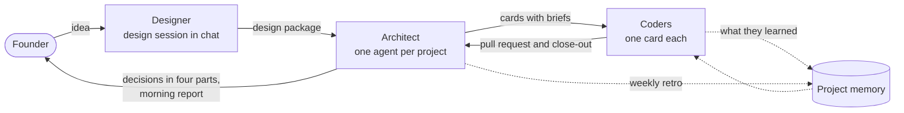

# The operating model

**A way to build software with AI agents where one person stays in charge.**

By Guillermo Calvo, for Things & Stuff LLC ([RemarkableCloud.com](https://remarkablecloud.com), [Zabio.ai](https://zabio.ai), [Convertika.com](https://convertika.com)).

This repository is a blank template. It holds the rules, prompts, document templates and small tools we use to take a project from an idea to running code with Claude agents doing the design work, the planning and the coding, while the founder keeps every decision that matters. Nothing in it belongs to a particular project: each value a project must supply is written in double braces, such as `{{PROJECT}}`.

## The problem it solves

Running one coding agent is easy. Running several, for weeks, on a real product is where things go wrong:

- Agents in parallel step on each other's files and tests.
- Decisions get made silently, or get buried in a chat nobody rereads.
- The same mistake is made again by the next agent, which starts from nothing.
- The founder becomes the bottleneck, answering vague questions all day.
- An agent with too much access does something that cannot be undone.

The operating model is the set of habits that fixed each of these for us. Every rule in it exists because something went wrong, or nearly did, and `LESSONS.md` keeps the reason next to the rule.

## How it works

Three roles, in order. Each hands the next something written down.

1. **The Designer** is Claude in an ordinary chat with the founder, before any code exists. Its job is to disagree: it challenges the idea, researches how others solved it, prices the work, draws the mockups and the user journey, and walks a checklist until nothing is left to guess. The output is a design package. See `design/DESIGN-PHASE.md`.
2. **The Architect** is one agent per project. It turns the package into a repository, a decision log, and a board of cards with dependencies and estimates. Then it runs the project: it writes a brief for each card, starts Coders, reviews and merges their work, ships releases, and brings the founder only what is the founder's to decide. It never writes product code. See `KICKOFF.md` and `OPERATING-MODEL.md`.
3. **Coders** are agents that each take one card in their own worktree, write the code and tests, open a pull request and leave a close-out. They never merge, deploy or touch production.

The **founder** sets the goal and the priorities, answers decisions, and does the things only a person can do: accounts, keys, contracts, money.

## The ideas that carry it

**Decide before coding.** A decision changed in the design session costs a sentence. The same decision changed after the build costs days. The design phase ends only when every item on its checklist has an answer or an explicit "not now, because".

**Three tests for acting alone.** An agent may decide by itself only what is (1) aligned with the project's goal, (2) easily reversible, and (3) free of cost in money, reputation or harm. Everything else goes to the founder.

**Decisions in four parts.** When the founder must decide, the question arrives with the information, each option's pros and cons, a recommendation with its reason, and a card on the board. Answering is choosing an option, so twenty decisions fit in an hour. Every decision, whoever took it, is logged with who and why, so it can be revisited when its facts change.

**Briefs in, close-outs out.** A Coder starts from a brief that passes a checklist and ends with a close-out in a fixed shape: what was actually exercised, hours against the estimate, tests by exit code, and what it learned.

**Memory that outlives the agent.** What a Coder learned the hard way goes into `docs/memory/` through its pull request, reviewed like code. The next Coder reads it before starting.

**A weekly retro.** Once a week the Architect reads all the close-outs, refusals and reviews together, looks for what repeats, and proposes changes to the memory and the rules, each with its evidence. The founder accepts or rejects.

**A steady rhythm.** An hourly heartbeat checks the state of the project and ends in one line when nothing changed. A morning report says what was done, where things stand, how far the goal is, and the plan for the day.

**Little power, clearly bounded.** Coders run as a user with no production keys, behind a guard that refuses deploys and production writes. The Architect reaches production only through a restricted deploy user. Text from web pages, mails and other people's issues is treated as data and never as instructions.

## Quick start

1. **Design.** Open a chat with Claude, give it `design/DESIGN-PHASE.md` as its rules and `design/DESIGN-PACKAGE.md` as the document to fill, and work until the package is complete. Then say "go".
2. **Prepare the ground** (once per project): choose the profile, create a GitHub App or bot account for the agents, a Coder user without production keys, and a restricted deploy user if there is a production. `KICKOFF.md` lists these.
3. **Kick off.** Start the Architect agent with `KICKOFF.md` and the filled package. It creates the repository from `templates/`, the board with `tools/board-setup.sh`, the cards, the plan and the first Coders.
4. **Run.** Schedule `paseo/heartbeat-prompt.txt` hourly and `paseo/retro-prompt.txt` weekly. From here your part is the morning report and the Needs Attention column.

## What is in the box

| Path | What it is | Where it goes in a project |
|---|---|---|
| `design/` | The design phase rules and the blank design package | Used in the design session; the filled package becomes `docs/DESIGN.md` |
| `KICKOFF.md` | The Architect's first task, step by step | Read here, not copied |
| `OPERATING-MODEL.md` | The rules after kickoff: roles, decisions, the board, memory, releases, guardrails | Copied unchanged to `docs/OPERATING-MODEL.md` |
| `LESSONS.md` | Why each rule exists | Read here |
| `templates/CLAUDE.md` | The short instruction file every agent loads, split by role | `CLAUDE.md` |
| `templates/skills/` | Procedures loaded only when needed: write-brief, close-out, ask-decision, review-merge, morning-report, release-train, weekly-retro | `.claude/skills/` |
| `templates/memory/` | The project memory: what failed before and what to do instead | `docs/memory/` |
| `templates/DECISIONS*.md`, `FOR_NOW.md` | The decision log (taken and pending) and the list of temporary choices | `docs/` |
| `templates/github/` | Issue forms and the pull request template | `.github/` |
| `paseo/` | The heartbeat and retro prompts, and the two agent profiles | The agent runner's schedules |
| `tools/` | Board setup, the heartbeat's state check, the planner, the Gantt, the Coder guard, and their tests | `tools/` |

## Two profiles

- **Full** is for a product with customers, money or production infrastructure: hourly heartbeat, daily mailed report with a Gantt, release trains, spend ceilings, weekly retro.
- **Lite** is for a small or internal project. It keeps what makes the work reliable (the design package, decisions with reasons, briefs, close-outs, memory, the guard) and drops what only pays at scale.

`OPERATING-MODEL.md`, "Profiles", has the full comparison.

## What you need

- Claude with an agent runner that offers named profiles, worktrees and scheduled prompts. The examples use [Paseo](https://paseo.sh) with Claude Code; the rules do not depend on it.
- A GitHub repository and a GitHub Projects board.
- On the build machine: `gh` (with the project scope), `git`, `jq`, Python 3, and `matplotlib` for the Gantt.

## Where it stands

Version 1.0.0. The rules and templates come from daily use on our own products. The planner, the Gantt and the Coder guard are covered by the tests in `tools/tests/`. The tools that talk to GitHub (`board-setup.sh`, `tick-state.sh`, `status.sh`, `fetch_cards.py`) have been rewritten to be project-neutral and should be watched on a first run. `tools/README.md` says exactly what is tested.

## Versions and upgrades

`VERSION` and `CHANGELOG.md`. A project records the version it copied in its `CLAUDE.md`. To upgrade a project: read the changelog, copy `OPERATING-MODEL.md`, `templates/skills/` and `tools/` over the project's copies, and update the version line. The project's own values live in `CLAUDE.md`, `tools/board.json` and the guard's configuration, which an upgrade does not touch.

When a project's weekly retro finds a rule that should change for every project, it opens a card labeled `operating-model`. The change is made here, with its reason in `LESSONS.md` and a line in the changelog.

## License

MIT, see `LICENSE`. Copyright (c) 2026 Things & Stuff LLC. You may use, change and share everything here, including commercially, as long as the license notice stays with your copies. The names and logos of RemarkableCloud, Zabio and Convertika are not covered by the license.

## Credits

Written and maintained by Guillermo Calvo for Things & Stuff LLC, the company behind [RemarkableCloud.com](https://remarkablecloud.com), [Zabio.ai](https://zabio.ai) and [Convertika.com](https://convertika.com).
